# FPGA CFAR + CNN Cascade for SAR Ship Detection

A two-stage ship detector for synthetic aperture radar (SAR) images, built for a low-cost FPGA.
An **integer Weibull CFAR prescreen** finds almost every ship, and a small **INT8 CNN** removes the false alarms.
Both stages run on a Terasic **DE10-Standard (Cyclone V 5CSXFC6D6F31C6)**, and the board output is
**bit-exact** to the Python golden models on all 5,604 HRSID images.

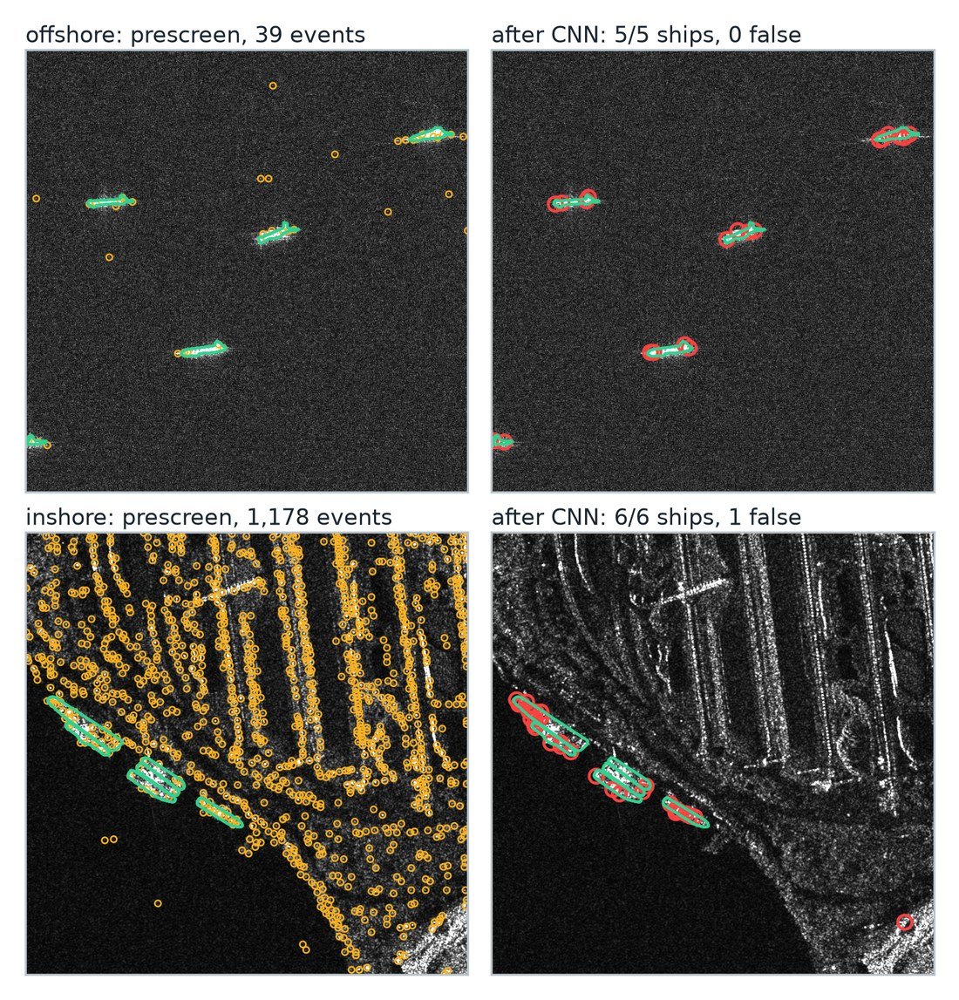

*Two HRSID test images, results read back from the FPGA. Left: prescreen events (yellow). Right: events accepted by the
CNN (red), with the annotated ships outlined in green. Open sea: 39 events → 5 of 5 ships, 0 false. Harbour: 1,178 events → 6 of 6 ships, 1 false.*

---

## Results at a glance

HRSID official test split: 1,962 images of 800 × 800 pixels, 5,918 ships. A ship is found when a detection lies within 4 pixels of its mask.

| Stage | Ships found | False alarms / image |
|---|---|---|
| Pixel-level Weibull CFAR, 17/13 window, P<sub>fa</sub> = 10⁻³ (floating point) | 89.0 % | 1,654 (clusters) |
| Pixel-level Weibull CFAR, 51/41 window, P<sub>fa</sub> = 10⁻³ (floating point) | 97.6 % | 1,122 (clusters) |
| **Integer pooled prescreen** (this design) | **99.63 %** | 165.5 (events) |
| **Prescreen + INT8 CNN**, 97 % retention target (this design) | **96.40 ± 0.06 %** | **3.02 ± 0.10** (events) |

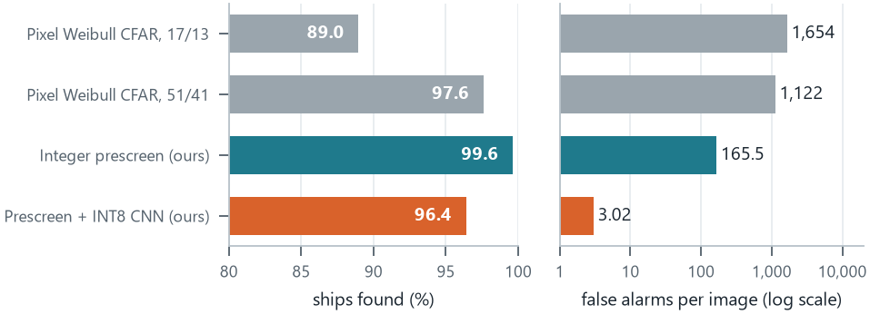

The CNN removes **98.2 %** of the prescreen's false events for 3.2 points of recall. The CNN threshold sets the trade-off and is
a register on the FPGA, so the operating point changes without a new bitstream:

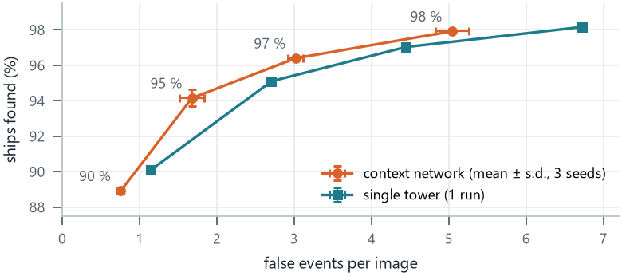

| Hardware (Cyclone V 5CSXFC6D6F31C6, Quartus Prime Lite 21.1) | Prescreen alone | Full cascade |
|---|---|---|
| ALM | 826 (2 %) | 11,856 (28 %) |
| M10K blocks | 181 (33 %) | 394 (71 %) |
| DSP blocks | 8 (7 %) | 96 (86 %) |
| Clock | 100 MHz | 50 / 100 MHz |
| Worst setup slack (4 corners) | +0.884 ns | +3.971 / +0.489 ns |
| Time per 800 × 800 frame | 9.005 ms (71.1 Mpixel/s) | 9.006 ms + 0.332 ms per candidate (median 19.97 ms) |

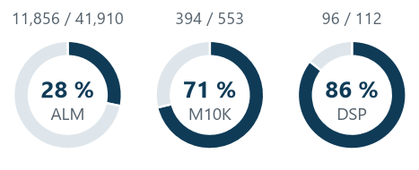

* **Bit-exact on the board:** all 5,604 HRSID frames and 1,015,171 events produce identical events, INT8 logits and decisions on the FPGA and in the golden models.
* **Small network:** 74,609 parameters (0.075 M) and 2.31 M multiply–accumulates per candidate. All weights are held in on-chip ROM.
* **Integer arithmetic costs nothing:** over 896,640,000 decisions, the integer and real-valued prescreens disagree on 5.6 ppm, and their event sets are identical.

---

## How it works

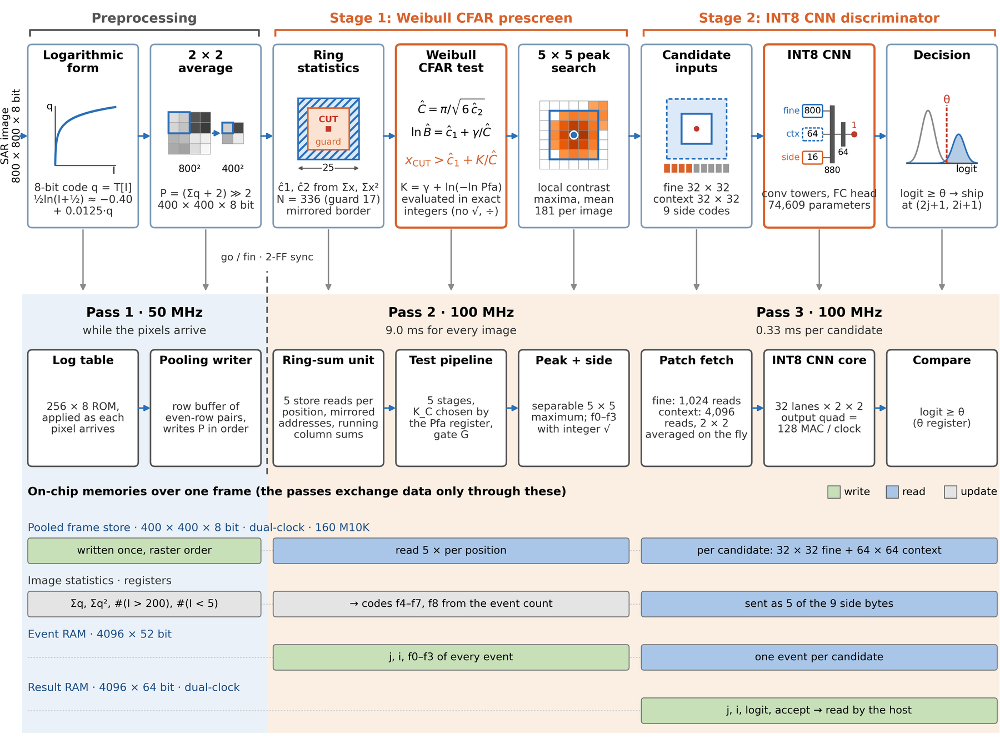

The frame is processed in three passes that exchange data only through on-chip memories:

1. **Pass 1 (50 MHz, while the pixels arrive).** Each pixel is turned into an 8-bit log code by a 256 × 8 ROM. The codes are averaged over 2 × 2 blocks into a 400 × 400 pooled frame, and four image statistics are accumulated.
2. **Pass 2 (100 MHz, 9.0 ms).** A Weibull CFAR test runs on every pooled cell with a 25 × 25 window and a 17 × 17 guard region (336 reference cells, mirrored borders). A contrast gate and a 5 × 5 peak search follow, and each target becomes one event.
3. **Pass 3 (100 MHz, 0.33 ms per event).** For each event the CNN receives a 32 × 32 fine patch, a 32 × 32 context patch and nine side codes. It produces an integer logit, and the event is accepted when the logit ≥ θ.

<details>
<summary><b>Pseudocode of the whole cascade</b></summary>

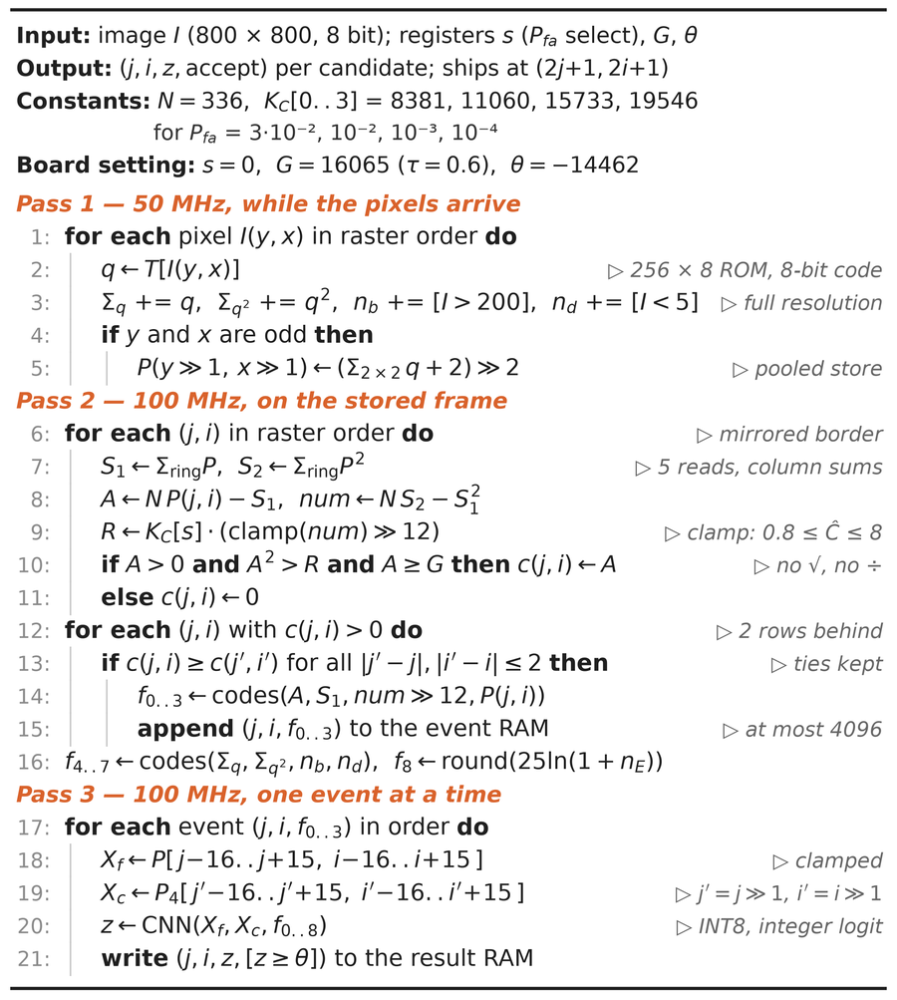
</details>

### Weibull CFAR without square roots or divisions

In the log domain a Weibull variable follows a Gumbel (location–scale) distribution. The method-of-log-cumulants estimates are therefore in closed form, and the CFAR test becomes

$$y_0 > \hat c_1 + \frac{K}{\hat C},\qquad \hat C = \frac{\pi}{\sqrt{6\hat c_2}},\qquad K = \gamma + \ln(-\ln P_{fa}).$$

With the ring sums $S_1$ and $S_2$, multiplying by $N$ and squaring gives an equivalent integer test with no square root and no division:

$$A > 0 \;\text{ and }\; A^2 > K_C\,(num \gg 12),\qquad A = NP - S_1,\quad num = NS_2 - S_1^2 .$$

A ring-sum unit keeps running column and row sums, so each position needs 5 memory reads instead of 336. The test is a 5-stage pipeline:

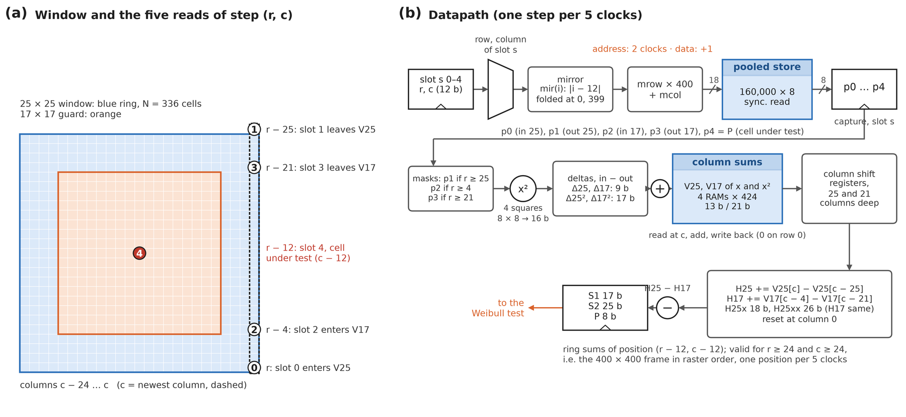
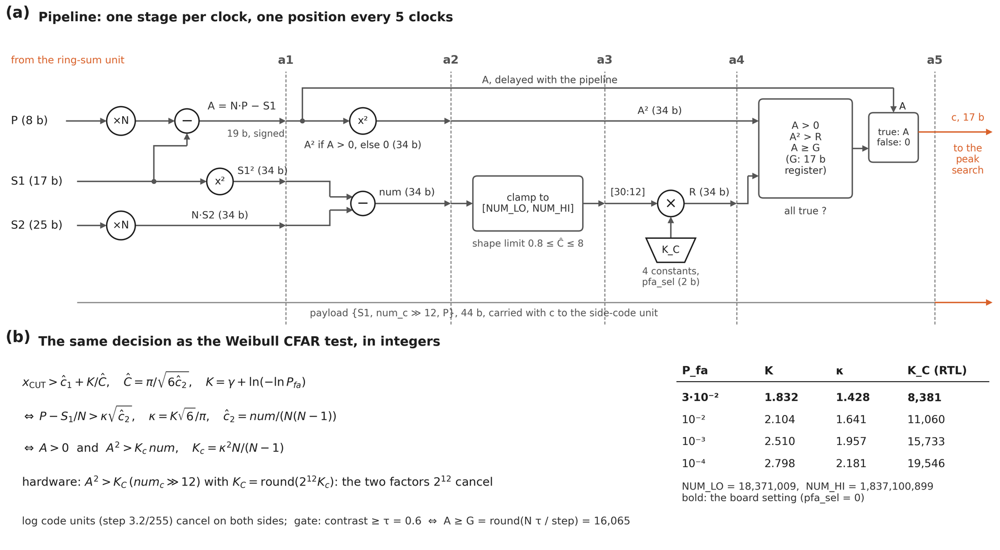

### INT8 CNN

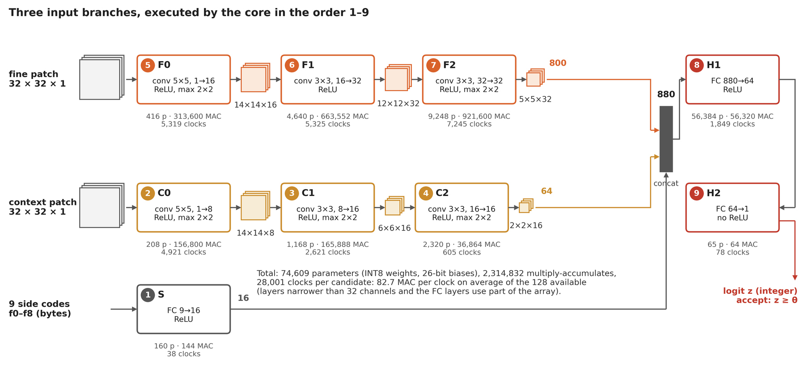

The network has a fine tower, a context tower and a side-code layer, followed by a two-layer head. It is trained with a
multiple-instance scheme (each ship's two best events are the positives) and hard-negative mining, then fine-tuned with
quantization-aware training to INT8 weights and per-channel integer requantization. The core runs a 32 × 4 multiply–accumulate array
fed by parity-banked feature memories, so the four inputs of a 2 × 2 output block are read in the same clock:

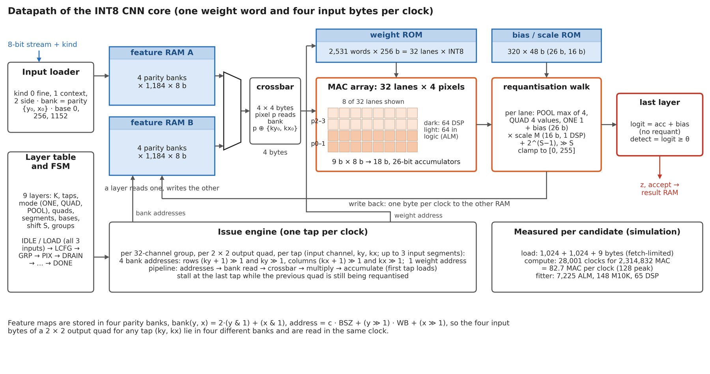

### Timing

Cycle-accurate timing from RTL simulation of the complete design (pass 2 per position, pass 3 per candidate):

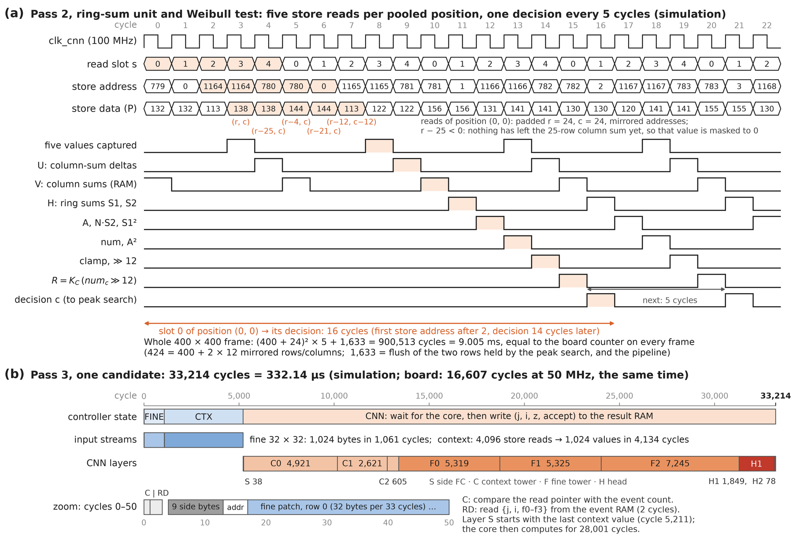

Measured on the board: every frame follows the cycle law t = 9.006 ms + 0.332 ms × n for n candidates, exactly, on all 5,604 frames.

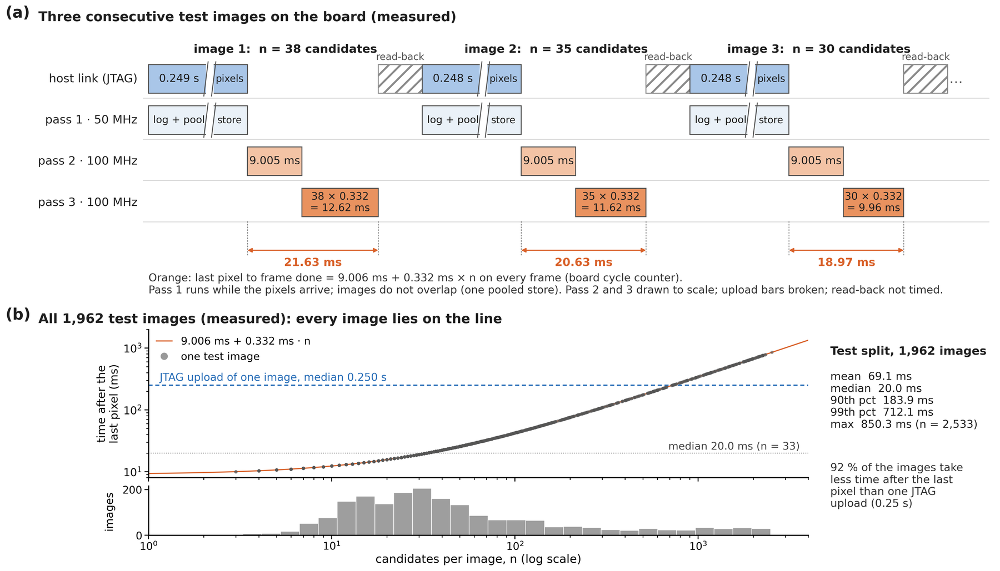

FPGA cost of each unit (fitter, per entity):

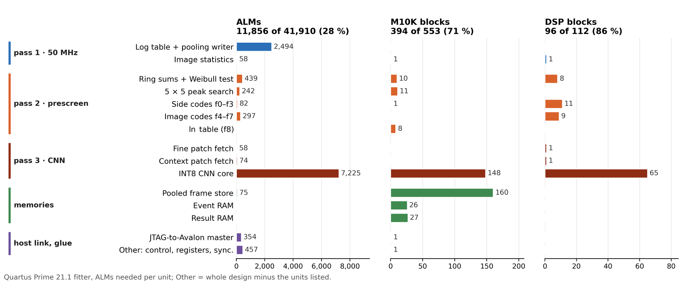

---

## Run the demo

`demo/demo_cascade.py` runs one HRSID image through the cascade and draws the result, on the board or in software.

```bash
# software only (bit-exact golden models), no board needed
python demo/demo_cascade.py --image P0128_1800_2600_3000_3800.png --sim

# on the DE10-Standard: program the bitstream first, then
quartus_pgm -c "DE-SoC [USB-1]" -m JTAG -o "p;_quartus/cascade_ctx_jtag/output_files/cascade_ctx_jtag_top.sof@2"
python demo/demo_cascade.py --image P0128_1800_2600_3000_3800.png
```

In board mode the script uploads the image over JTAG, reads back every event, logit and accept flag plus the on-chip cycle counters,
and checks the board output against the golden models (`board vs golden model: IDENTICAL`). Change the operating point with
`--theta` (integer logit): −5979 (90 % retention), −10695 (95 %), −14462 (97 %, default), −17056 (98 %).

Requirements: Python 3 with numpy, scipy, pillow, matplotlib and PyTorch (to load the INT8 tables); Quartus Prime Lite 21.1
for the board. The HRSID dataset is not included: download it from its authors and place it in `HRSID/` (with `images/` and
`annotations/`), or pass `--hrsid <folder>`.

---

## Repository layout

| Path | Contents |
|---|---|
| `rtl/prescreen/` | Integer pooled Weibull prescreen (ring sums, Weibull test, 5 × 5 peak), testbenches, regression against the golden model (`tb/run_regression.sh`) |
| `rtl/ctx/` | Context cascade: event RAM, fine/context patch fetch, side-code unit, two-clock control, JTAG wrapper (`build_cascade_ctx.sh`, `check_cascade_ctx.py`) |
| `rtl/cnn/` | INT8 CNN cores (single tower and fine + context), layer tables, golden-vector testbenches |
| `rtl/cascade/` | Pooled frame store, pooling writer, single-tower two-clock cascade, on-board demo (`BOARD_BRINGUP.md`) |
| `rtl/common/`, `CFAR_Weibull/`, `lut/`, `_common/` | Shared Weibull CFAR building blocks and the MATLAB reference models |
| `_quartus/` | Quartus 21.1 projects with board-ready `.sof` files: `cascade_ctx_jtag` (full cascade, used for all board results), `cascade_ps_jtag`, `prescreen_probe`, `cascade_jtag`, `cascade_de10` (self-contained on-board demo) |
| `_comparison/fixedpoint/` | Bit-exact integer golden models (`prescreen_fx.py`, `side_fx.py`), whole-dataset evaluation, seed statistics |
| `_comparison/cnn/` | CNN training (float and INT8 QAT), export to RTL tables, board-sweep host scripts (`sweep250/board/`) |
| `_comparison/pd_study/` | Prescreen design study (window, pooling, gate, peak search) |
| `_comparison/Results/` | Result tables, the INT8 models of every training run (`hw/`), and the raw whole-dataset board sweep (`sweep_ctx_all/`) |
| `demo/` | Demo script (board or software) |
| `docs/images/` | Figures used in this README |

## Limitations

* Power and energy were not measured.
* On the board, throughput is limited by the JTAG test link (0.25 s to upload one frame), not by the FPGA fabric.
* On SSDD the prescreen finds 92.1 % of the ships: medium-sized ships wider than the guard region mask themselves. The CNN must also be retrained for each sensor.
* Detection is scored as events within 4 pixels of a ship, not as boxes at IoU 0.5, so the numbers are not directly comparable with box-based deep detectors.

## Data

The results use the HRSID dataset (S. Wei *et al.*, "HRSID: A High-Resolution SAR Images Dataset for Ship Detection and Instance
Segmentation," *IEEE Access*, vol. 8, 2020) and, for the generalisation test, the official SSDD release. The demonstration images
above are HRSID test images. Neither dataset is redistributed here.
